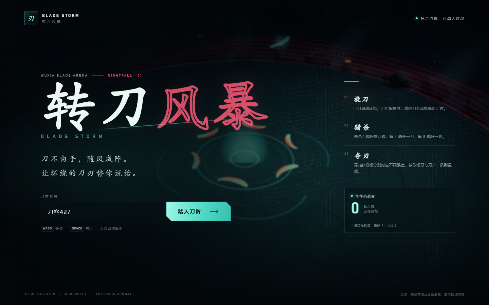
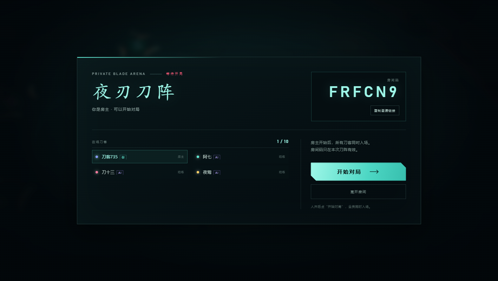
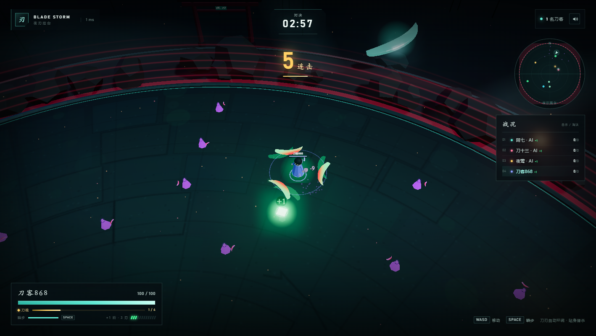
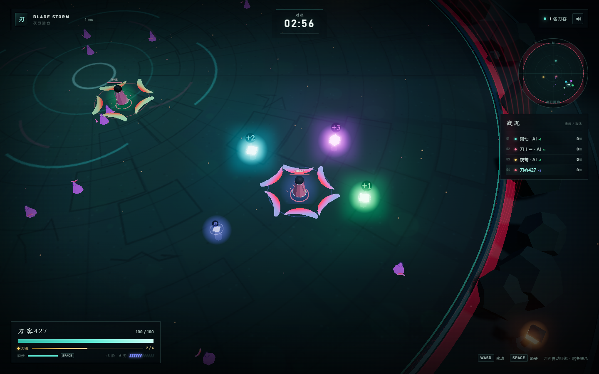
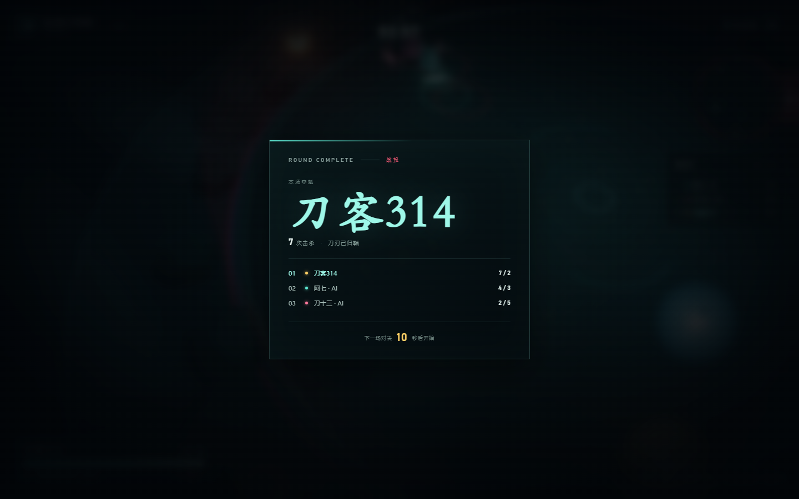
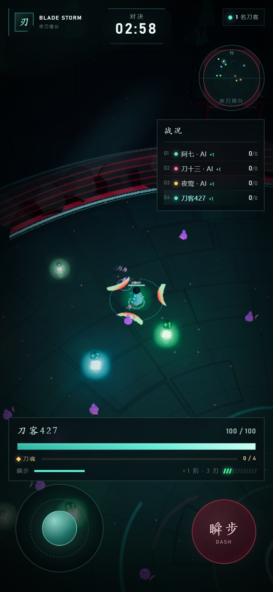

# 转刀风暴 · BLADE STORM

[](https://render.com/deploy?repo=https://github.com/st467379674-ai/blade-storm)

一款用 three.js 制作的 **3D 多人联机转刀竞技游戏**。核心循环参考转刀类游戏：刀刃自动环绕角色旋转，贴身碰撞扣血，击杀后变强、变大、增加刀刃，在毒圈收拢前活到最后。





## 立即开玩

```bash
npm install
npm run dev
```

打开 **http://localhost:3000**。

1. 输入刀客名号，点 **创建刀阵**
2. 把房间码或邀请链接发给朋友
3. 朋友输入房间码，或直接打开链接加入大厅
4. 房主点 **开始对局**，所有真人同时入场

- 每个房间默认补 3 个 AI 陪练，最多 10 名真人同场。
- 房间邀请链接格式：`http://你的地址/?room=ABC123`。
- 公网联机时，把项目部署到一台服务器，放行 HTTP/WebSocket 端口即可；客户端与 WebSocket 使用同源地址。
- 生产模式：`npm run build && npm start`（同样使用 3000 端口，支持 `PORT` 环境变量）。

环境要求：Node.js 20+。无需数据库，也无需任何外部美术资源。

## 房间与开局

- 房间码为 6 位大写字母/数字，避开 `0/O/1/I` 等易混字符。
- 创建者是房主；房主可以开始对局。房主离开时，房主自动移交给下一位真人。
- 真人可以在大厅等待，也可以在开局后通过房间码/链接中途加入。
- 同一进程支持多个互相隔离的房间，不同房间的玩家、刀傀、毒圈和结算互不影响。
- 对局结束显示 10 秒战报，然后自动回到当前房间大厅，由房主决定下一局。
- 房间没有真人后会立即关闭，不会留下空房。

## 广域网部署

项目已包含长期部署所需配置：

- `Dockerfile` / `docker-compose.yml`：单容器生产部署，带 `/api/status` 健康检查。
- `render.yaml`：Render Blueprint，连接 GitHub 仓库即可部署。
- `deploy/Caddyfile`、`deploy/nginx.conf`：带 HTTPS 与 WebSocket Upgrade 的反向代理示例。
- `deploy/cloudflared.yml`：Cloudflare Named Tunnel（固定域名、不暴露端口）。
- `deploy/README.md`：四种部署方案的完整步骤与注意事项。
- 生产静态服务已内置 **gzip** 和 `/assets/*` 一年 immutable 缓存：主 JS 从约 605KB 压到约 162KB，广域网首屏明显更快。

临时分享最快的方式：

```powershell
ssh -o StrictHostKeyChecking=no -o ServerAliveInterval=30 -R 80:127.0.0.1:3000 nokey@localhost.run
```

会得到一个支持 WebSocket 的临时 HTTPS 地址；但免费 SSH 隧道在重连后会**更换域名**，旧地址直接失效。它只适合临时试玩，长期运行请使用 Docker + 域名或 Render。

> 当前游戏状态在单个 Node 进程内存中。多副本部署前需要额外做房间路由和共享状态，当前配置请保持**单实例**。

## 操作

| 平台 | 移动 | 瞬步 | 其他 |
| --- | --- | --- | --- |
| 桌面 | `WASD` / 方向键 | `Space` | `M` 静音 |
| 手机 | 左侧虚拟摇杆 | 右侧「瞬步」按钮 | 自动旋刀，无需攻击键 |

刀刃自动旋转。你要做的是走位、贴身、绕后，以及用瞬步规避或追击。瞬步期间短暂无敌，冷却 2.7 秒。

## 玩法规则

- **自动旋刀**：初始 3 把大型弯刀环绕身体。刀刃碰到敌人身体造成伤害，同一攻击者对同一目标有 0.42 秒命中间隔。
- **刃阶压制**：每把转刀有 **+1 ～ +6 刃阶**。双方刀刃相撞时：
  - 同阶：火花四溅，双方弹开；
  - 高阶打低阶：**高阶直接击落低阶一把刀**，刀片掉在碰撞点，任何人都能捡；
  - 低阶只剩最后一刀时不会被剥光，改为受到一次重击伤害。
  - 同一对玩家 1.35 秒内最多打落一次；同一受害者 2.1 秒内最多丢一把，避免被瞬间剥光。
- **杀戮成长**：每次击杀 +12 最大生命，回复 28 生命；每 2 次击杀 +1 把刀，每 3 次击杀 +1 刃阶（AI 成长更慢）。最多 **+6 阶 / 12 把刀**。刃阶还会增加刀长、旋刀半径、伤害和体型。
- **刀傀与刀魂**：80 米大战场上会持续刷新 38+ 只刀傀。击杀刀傀获得 1 点刀魂：
  - 每 **4 魂**：刀刃 +1
  - 每 **8 魂**：刃阶 +1
  - 刀傀 5.5～9.5 秒后在安全区重生，前期可专心刷怪发育。
- **成长道具分阶**：锻刃按颜色分为三档强度，场上若没有高阶锻刃会优先补充：
  - 🟢 **青锻 +1**：刀刃 +1
  - 🔵 **蓝锻 +2**：刃阶 +1、刀刃 +1
  - 🟣 **紫锻 +3**：刃阶 +2、刀刃 +2
  - 其他道具：刀片（刀刃 +1）、疾风（移速 +34%）、锋锐（伤害 ×1.5）、护体（吸收 40 伤害）
- **毒圈**：开局 45 秒后开始收缩，130 秒内从半径 40 收到 8，圈外持续掉血。
- **赛制**：3 分钟一场，死亡 3.4 秒后重生。时间结束按击杀数排名，10 秒战报后回到房间大厅，由房主再开下一场。
- **补给节奏**：初始 10 个强化物，之后每 2.4～3.8 秒补充一个，常规场上上限 14 个；每名真人出生点附近额外生成一个保底锻刃（不计入常规上限）。

## 技术实现

- **客户端**：three.js（WebGL）、InstancedMesh 刀刃与刀傀、合批角色、程序化纹理与几何体、大型弯刀 Shader（红芯/亮刃口/刃阶变色）、UnrealBloom 后期、客户端移动预测、远端位置/角度插值、房间大厅与邀请链接、WebAudio 程序化音效。
- **服务端**：Node.js + `ws`，30Hz 权威模拟、20Hz 状态广播。房间管理、房主/开局、移动、长刀刃线段碰撞、刃阶压制、刀片掉落、刀傀 AI 与刀魂成长、拾取、毒圈、Bot 全在服务端计算，客户端只发送输入。
- **单端口部署**：开发环境由 Vite middleware 挂在同一个 HTTP Server 上，HMR 与游戏 WebSocket 共用端口；生产环境直接托管 `dist/`。
- **无外部素材**：地面、月亮、光晕、竹简/UI 全部由 Canvas 与 three.js 程序化生成。

```
.
├─ index.html
├─ server/
│  ├─ index.js          # HTTP + Vite middleware + WebSocket + 30Hz 循环
│  ├─ rooms.js          # 房间码、房主、大厅、开局、多房间隔离
│  └─ game.js           # 权威对战模拟、刀傀 AI、Bot AI、毒圈、拾取、成长
├─ src/
│  ├─ main.js           # 入口、房间大厅、网络状态、HUD、雷达、触控
│  ├─ game.js           # 3D 场景、角色、刀刃、特效、镜头
│  ├─ net.js            # WebSocket 客户端
│  ├─ input.js          # 键鼠与虚拟摇杆
│  ├─ audio.js          # WebAudio 程序化音效
│  └─ style.css         # 视觉与响应式 HUD
├─ scripts/
│  ├─ build.mjs         # 构建包装（Windows 临时目录兜底）
│  ├─ logic-test.mjs    # 刀刃击落/刀傀/刀魂/成长道具分级测试
│  └─ smoke-test.mjs    # 建房/加入/房主开局/双客户端真实联机冒烟测试
└─ docs/                # 界面截图
```

## 打击感（汁水）补全

对照 12 条打击反馈逐项检查后，这轮补的是“命中确认”，不是无脑堆特效：

- **受击闪白**：命中目标时角色身体材质瞬间发白，命中点额外出现白色闪光精灵；夺刃/击杀使用更大的闪光。
- **击退与挤压拉伸**：服务端已有实体击退，客户端再叠加视觉位移；受击角色和刀傀会短暂横向压扁、纵向回弹，再恢复原比例。
- **伤害飘字**：数字先放大冲过头再回落，随后减速上升、缩小淡出；暴击/重击字号更大、金色、抖动，普通伤害偏白，护盾吸收偏蓝。数字会随机左右错位，避免叠在一起。
- **粒子与方向**：命中火花沿攻击方向喷出，击杀爆散碎片，夺刃双重粒子；不是纯随机圆球。
- **顿帧**：本地击杀、夺刃、重击时短暂放慢客户端世界 28～75ms，镜头震屏继续，制造“打实了”的停顿。
- **震屏**：普通命中、重击、击杀、死亡、夺刃按伤害和事件强度分级，不再是单一幅度。
- **冲击波**：命中、击杀、夺刃分别有白/金/红色的快速扩散环。
- **刀刃残影**：每名玩家增加 1 个 InstancedMesh 残影层，旋转时形成短拖尾；低画质自动关闭，保持之前的 draw call 预算。
- **连击与音调**：连续命中/击杀累积连击，HUD 顶部弹出金色连击数字；命中音效每 24 连击升高一个八度，连击越高越紧。
- **Bloom**：保留原有发光溢出；新增闪光精灵和残影会自然叠加。
- **不做/克制**：
  - 不做枪口火光和子弹拖尾——这是自动旋转刀，不是射击游戏；用刀刃残影和命中闪光替代。
  - 不做全屏白闪——会遮挡走位，改为目标身体闪白 + 命中点闪光。
  - 不做几十个同屏伤害数字和百万级单位缩写——当前伤害数值小、命中频率有限；用错开排版、上限和暴击差异化控制可读性。
  - 不做数字合并累加——逐次命中反馈本身是转刀节奏的一部分，合并会削弱“每一刀都算数”的感觉。
  - 不做独立的分数滚动条——局内已有击杀/死亡和结算排名，连击数字承担即时反馈；再多一个滚动分数会和 HUD 抢注意力。



## 性能优化

这一轮专门处理了「人一多、刀一多就卡」的问题：

- **刀刃实例化**：每名玩家最多 12 把刀，过去每把刀有刀身、描边、刀柄、护手、光晕、拖尾 6 个对象；现在每名玩家只用 **1 个 InstancedMesh** 绘制全部刀刃，外加 1 个角色光环和 1 层低透明度残影（低画质关闭）。10 人 120 刃的实体刀刃绘制量从 720 个对象压到 10 个实例化 draw call，残影再增加 10 个。
- **刀傀实例化**：刀傀身体和旋转小刀改为 InstancedMesh，面具改为单个 Points；43 只刀傀从约 200 个对象降到 3 个 draw call。
- **角色合批**：玩家身体各部件烘焙成 1 个顶点色 Mesh，围巾合并成 1 个 Mesh，角色不再投射实时阴影（保留脚下软阴影）。
- **场景静态物实例化**：62 块岩石、48 棵树、48 座远山分别合并为 InstancedMesh，静态场景 draw call 大幅下降。
- **静态阴影只算一次**：所有会投影的物体都是静态的，阴影贴图只在首帧更新一次，不再每帧重算。
- **自动性能模式**：当在线人数 ≥7 或场上刀刃总数 ≥38，或 FPS 持续低于 44 时，自动关闭 Bloom、关闭实时阴影、降低渲染分辨率；压力解除 8 秒后恢复。
- **降低默认分辨率上限**：桌面从 1.8× 降到 1.35×，移动端从 1.45× 降到 1.05×。
- **特效限流**：远处命中、刀傀命中不再生成粒子；低画质下粒子和伤害数字上限进一步降低。

10 人 / 120 刃压力测试（桌面 1440×900，刃影加入前）：场景约 **206 draw calls / 82k triangles**。本轮新增的刃影是每名玩家 1 层，且低画质自动关闭；之前的实现仅刀刃本身就会产生约 720 个对象绘制。

也可以手动锁画质：

- `http://localhost:3000/?quality=high`：强制高画质
- `http://localhost:3000/?quality=low`：强制性能模式

## 验证

```bash
npm run build       # 生产构建
npm run test:logic  # 刃阶击落、刀傀掉落、刀魂成长、成长道具分级、补给频率
npm run test:net    # 启动无 Bot 测试服，建房→第二人加入→房主开局→互相命中
```

联机测试会验证：

1. 第一个客户端创建房间并成为房主
2. 第二个客户端用房间码加入同一房间
3. 房主开局后，两人同时进入倒计时和 `playing`
4. 服务端权威移动生效，刀刃命中并扣血
5. `/api/status` 在线人数正确

## 本轮优化

- **建房与房间码**：6 位房间码、邀请链接、大厅、房主开局、房主移交、多房间隔离全部接入。
- **真人进房**：每个房间最多 10 名真人，默认 3 个 AI 陪练；支持大厅等待、开局后中途加入。
- **打击汁水**：受击闪白、击退/挤压、弹簧飘字、定向火花、顿帧、分级震屏、冲击波、刀刃残影、连击与音调递进。
- **战场再次扩大**：半径从 24 扩到 **40（80 米直径）**，镜头、阴影、场景装饰、毒圈、雷达全部同步放大。
- **加入刀傀**：38+ 只小怪持续刷新，前期可以刷怪积攒刀魂，每 4 魂长一刀、每 8 魂升一阶。
- **成长节奏**：强化物初始 10 个、2.4～3.8 秒补充、上限 14 个；真人生点保底锻刃。
- **成长道具分色分级**：青锻 +1 / 蓝锻 +2 / 紫锻 +3，三种颜色对应三种强度，场上至少保留一个高阶锻刃。
- **早期遭遇减少**：拉大出生间距，前 20 秒 Bot 优先刷怪/拾取，不主动跨图追人；20 秒后才进入玩家猎杀。
- **刀傀可被旋转刀锋切割**：站在刀圈边缘会被刀锋命中，不会再钻进刀圈内部安全区。




## 目前范围

这是一个 **可联机开玩的 MVP**，不是完整商业版本。已经包含核心战斗、80 米战场、建房/房间码/大厅/房主开局、多房间隔离、刃阶压制、刀片掉落、刀傀 PvE、刀魂成长、分级道具、毒圈、Bot、复活、结算与移动端操作。

还没做的部分：账号系统、公开房间列表/快速匹配、武器图鉴与耐久、双指调整旋刀半径、观战、排行榜持久化、反作弊与限流。这些都可以在现有权威服务端结构上继续扩展。

如果之后还要继续压榨性能，可以下一步把拾取物也实例化，或者做更彻底的场景合批/远景 LOD。



## 移动端


